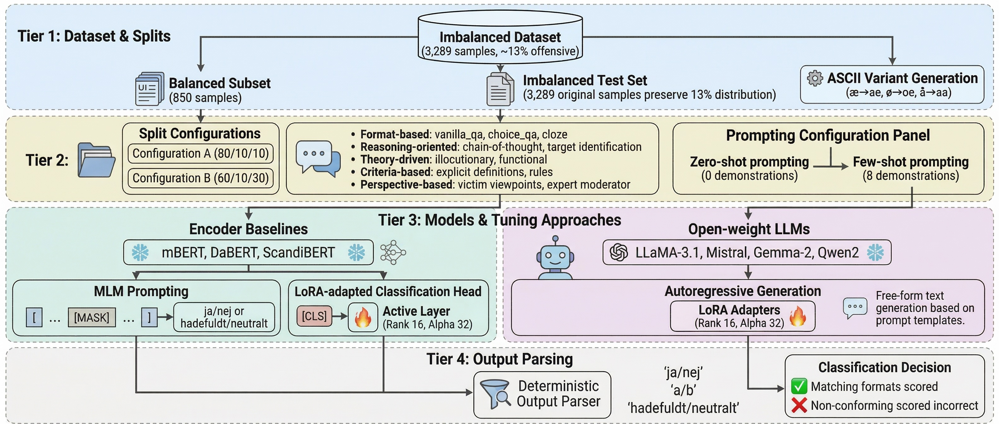

# Danish-LLM-HateSpeech

Code, data splits, prompts and configurations for

> **On the Effectiveness and Limitations of Open-Weight LLMs for Low-Resource Offensive Language Detection in Danish**
> Elnur Adl Zarabi, Amit Kumar, Adi Singh, Sierra Nelson, Megan Stubbs-Richardson, Taoran Ji
> *IEEE International Conference on Big Data (IEEE BigData 2026)*, Phoenix, AZ, December 2026. To appear.


---

## What the paper does

We study how far general-purpose open-weight LLMs get on Danish offensive language detection, a low-resource task with one public corpus. Four model families (Llama 3.1 8B, Mistral 7B v0.3, Gemma 2 9B, Qwen2 7B) are evaluated against three BERT-family encoders (mBERT, DaBERT, ScandiBERT) on the DKHate corpus, across eleven Danish prompting patterns in five design categories, zero-shot, 8-shot and after LoRA fine-tuning, under a balanced setting, the corpus's natural 13 percent class skew, and a balanced-train / imbalanced-test setting. We also measure cross-prompt transfer, the effect of transliterating æ, ø and å to ASCII, and the effect of explicit denoising instructions.

Three findings carry the paper. With a suitable prompt, zero-shot LLMs already pass our fine-tuned BERT baselines. Lightweight LoRA fine-tuning lifts the best balanced F1 to 0.84. Restoring the natural class skew pulls the best F1 down to 0.62, so balanced-only evaluation overstates deployment readiness.



## Headline numbers

Positive-class (offensive) F1 on the 80/10/10 split. Every value is a single run, see the paper's Limitations.

| Setting | Best zero-shot LLM | Best LoRA fine-tuned LLM | Best fine-tuned BERT (CLS) |
|---|---|---|---|
| Balanced (850 rows, 50/50) | 0.68 (Mistral) | **0.84** (Gemma) | 0.61 (DaBERT) |
| Imbalanced (3,289 rows, 13% offensive) | 0.45 (Qwen) | **0.62** (Gemma) | 0.39 (DaBERT) |
| Balanced train, imbalanced test | – | **0.70** (Gemma, illocutionary prompt) | 0.26 (DaBERT) |

Full per-pattern tables, the parse-failure audit, corrected macro-F1 and the cross-prompt transfer matrices are in the paper and its appendices.

## Repository layout

```
.
├── run_finetuning.py            # entry point: zero-shot + LoRA fine-tuning for the LLMs
├── prepare_splits.py            # regenerates the stratified splits under data/
├── src/
│   ├── config.py                # model ids, prompt patterns (zero-shot and 8-shot), decoding settings
│   ├── models.py                # loading, generation, deterministic output parsing
│   ├── metrics.py               # precision / recall / F1
│   ├── data_loader.py
│   └── finetuning/
│       ├── finetune_config.py   # LoRA and training hyperparameters
│       ├── trainers.py          # TRL SFT trainer wrapper, early stopping
│       ├── evaluation.py        # adapter loading, per-example prediction dumps
│       ├── run_finetuning.py    # the pipeline behind the top-level script
│       ├── run_encoder.py       # BERT experiments (CLS head fine-tuning, MLM prompting)
│       ├── encoder_models.py    # encoder wrappers and MLM scoring
│       └── run_cross_prompt.py  # train on one pattern, test on the other ten
├── data/dk_hate_processed/      # DKHate, processed copies, ASCII variants, pre-generated splits
├── experiment_log.txt           # log of the March 2026 run that produced the main tables
├── requirements.txt
└── LICENSE
```

## Setup

```bash
git clone https://github.com/PASHAADC/Danish-LLM-HateSpeech.git
cd Danish-LLM-HateSpeech
python -m venv .venv && source .venv/bin/activate
pip install -r requirements.txt
huggingface-cli login
```

Llama and Gemma are gated on Hugging Face. Accept their licenses on the model pages before the first run. The 7 to 9B models train in bfloat16 with LoRA and gradient checkpointing on a single GPU. Our March 2026 log reports about 15 GB of GPU memory allocated during fine-tuning.

## Data

The corpus is **DKHate** (Sigurbergsson and Derczynski, LREC 2020), 3,289 Danish Reddit and Facebook comments after processing, 425 of them labelled offensive. DKHate is distributed under CC BY 4.0 and is redistributed here under that license, unchanged in content, together with the derived files we used.

| File | Rows | What it is |
|---|---|---|
| `dkhate_complete.csv` | 3,289 | The full corpus, natural 13% skew. Basis of the **imbalanced** setting |
| `dkhate_balanced_1000.csv` | 850 | All 425 offensive rows plus 425 sampled non-offensive rows. Basis of the **balanced** setting |
| `*_ascii.csv` | same | The same files with æ, ø, å replaced by ae, oe, aa |
| `splits/{80_10_10,60_10_30}/{balanced,imbalanced,cross_balanced}/` | see below | Stratified train / val / test splits used in the paper |

Split sizes, as used in every table of the paper:

| Split | Variant | Train | Val | Test |
|---|---|---|---|---|
| 80/10/10 | imbalanced | 2,631 | 329 | 329 |
| 80/10/10 | balanced | 680 | 85 | 85 |
| 80/10/10 | cross_balanced | 679 | 85 | 329 (imbalanced test) |
| 60/10/30 | imbalanced | 1,973 | 329 | 987 |
| 60/10/30 | balanced | 509 | 86 | 255 |
| 60/10/30 | cross_balanced | 509 | 85 | 987 (imbalanced test) |

`cross_balanced` holds the imbalanced test set out first, then draws a class-balanced train and validation set from the remainder, so no test row is seen in training. To regenerate everything:

```bash
python prepare_splits.py
```

## Models

| Key | Hugging Face id |
|---|---|
| `llama` | meta-llama/Meta-Llama-3.1-8B-Instruct |
| `mistral` | mistralai/Mistral-7B-Instruct-v0.3 |
| `gemma` | google/gemma-2-9b-it |
| `qwen` | Qwen/Qwen2-7B-Instruct |
| `bert_multi` | google-bert/bert-base-multilingual-cased |
| `dabert` | Maltehb/danish-bert-botxo |
| `scandibert` | vesteinn/ScandiBERT |

## Prompt patterns

All prompts are in Danish. The eleven patterns, grouped as in the paper:

| Category | Patterns | Key in `config.py` |
|---|---|---|
| Format-based | vanilla QA, choice QA, cloze | `vanilla_qa`, `choice_qa`, `cloze` |
| Reasoning-oriented | chain-of-thought (answer first), target identification | `cot`, `target` |
| Theory-driven | illocutionary act, social function | `illocutionary`, `functional` |
| Criteria-based | definition, rules | `definition`, `rules` |
| Perspective-based | victim perspective, expert moderator | `victim_perspective`, `expert_moderator` |

Zero-shot and 8-shot versions live in two `PROMPT_PATTERNS` blocks in `src/config.py`. Comment one in and the other out to switch. The 8-shot templates prepend eight fixed hand-written exemplars, four offensive and four not, none of them from the corpus. Model outputs are mapped to labels by a deterministic parser in `src/models.py`.

## Running the experiments

**LLMs, zero-shot and LoRA fine-tuned.** One call trains all four models on all eleven patterns for one split and one variant, evaluates the base model and the fine-tuned adapter on the test set, and writes metrics, per-example predictions and plots under `results/`.

```bash
# the six runs behind the main tables
python run_finetuning.py --split 80_10_10 --variant balanced
python run_finetuning.py --split 80_10_10 --variant imbalanced
python run_finetuning.py --split 80_10_10 --variant cross_balanced
python run_finetuning.py --split 60_10_30 --variant balanced
python run_finetuning.py --split 60_10_30 --variant imbalanced
python run_finetuning.py --split 60_10_30 --variant cross_balanced

# a subset of models or patterns
python run_finetuning.py --split 80_10_10 --variant balanced --models llama gemma --patterns vanilla_qa cot

# start a fresh shared results file
python run_finetuning.py --split 80_10_10 --variant imbalanced --clear-master
```

**BERT encoders.** CLS-head fine-tuning and zero-shot MLM prompting, resumable. Finished experiments are skipped based on `encoder_results.csv`.

```bash
python -m src.finetuning.run_encoder --stage all --split 80_10_10
python -m src.finetuning.run_encoder --stage all --split 60_10_30
python -m src.finetuning.run_encoder --stage cls --split 80_10_10 --variant balanced imbalanced
python -m src.finetuning.run_encoder --stage mlm --split 80_10_10
python -m src.finetuning.run_encoder --stage summary
```

**Cross-prompt transfer.** Fine-tune on one pattern and evaluate on the other ten.

```bash
python -m src.finetuning.run_cross_prompt --models llama gemma
```

**Orthography and denoising.** Point the dataset entries in `src/config.py` at the `*_ascii.csv` files for the transliteration arm. The denoising prompts are the standard templates with a sentence asking the model to ignore misspellings, slang and non-standard punctuation.

## Training and decoding settings

The values below are the ones in `src/finetuning/finetune_config.py` and `src/config.py` and the ones reported in the paper's Appendix B.

| | LLMs | Encoders |
|---|---|---|
| Adapter | LoRA r=16, α=32, dropout 0.05 on q, k, v, o, gate, up, down | LoRA r=16, α=32, dropout 0.05 on query, key, value, dense, plus the classification head |
| Optimizer | AdamW, lr 2e-4, weight decay 0.01, warmup 0.03 | AdamW, lr 2e-5, weight decay 0.01, warmup 0.1 |
| Batch | 1 per device × 8 accumulation steps | 16 |
| Epochs | up to 10, early stopping (patience 3 on validation loss), best checkpoint restored | up to 10, patience 3, best validation F1 |
| Precision | bfloat16, gradient checkpointing, no quantization | default |
| Decoding | nucleus sampling, temperature 1.0, top-p 0.9, 20 new tokens | not applicable |
| Seeds | splits seeded (42), generation unseeded | 42 |

Generation is sampled rather than greedy and no generation seed is fixed, so a re-run reproduces the paper's numbers in pattern, not cell for cell.

## Citation

```bibtex
@inproceedings{adlzarabi2026danish,
  title     = {On the Effectiveness and Limitations of Open-Weight {LLM}s for Low-Resource Offensive Language Detection in {D}anish},
  author    = {Adl Zarabi, Elnur and Kumar, Amit and Singh, Adi and Nelson, Sierra and Stubbs-Richardson, Megan and Ji, Taoran},
  booktitle = {Proceedings of the 2026 IEEE International Conference on Big Data (BigData)},
  year      = {2026},
  address   = {Phoenix, AZ, USA},
  publisher = {IEEE}
}
```

Please also cite the corpus:

```bibtex
@inproceedings{sigurbergsson-derczynski-2020-offensive,
  title     = {Offensive Language and Hate Speech Detection for {D}anish},
  author    = {Sigurbergsson, Gudbjartur Ingi and Derczynski, Leon},
  booktitle = {Proceedings of the Twelfth Language Resources and Evaluation Conference (LREC)},
  year      = {2020},
  pages     = {3498--3508},
  publisher = {European Language Resources Association}
}
```

## License and intended use

The code is released under the MIT License with Use Restrictions (see `LICENSE`). It may be used for research and content moderation. It may not be used to generate, promote or spread hateful or offensive content, or to build systems whose purpose is to evade its detection. The DKHate data is CC BY 4.0 and remains the work of its authors.

## Contact

Elnur Adl Zarabi, Texas A&M University-Corpus Christi, eadlzarabi@islander.tamucc.edu
